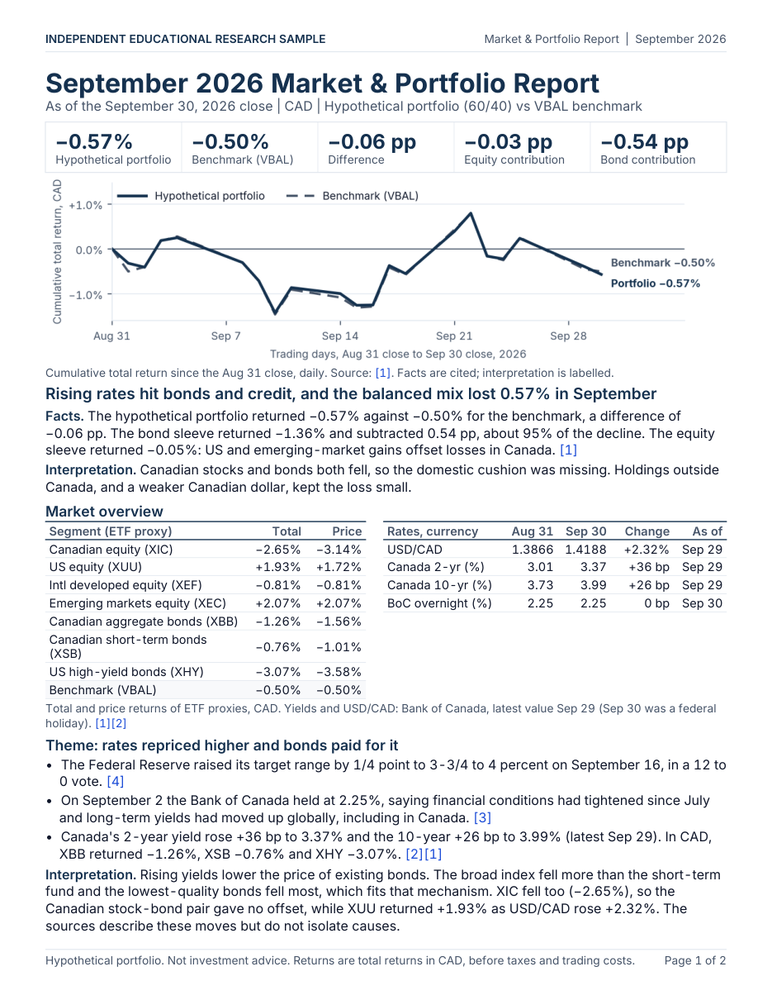
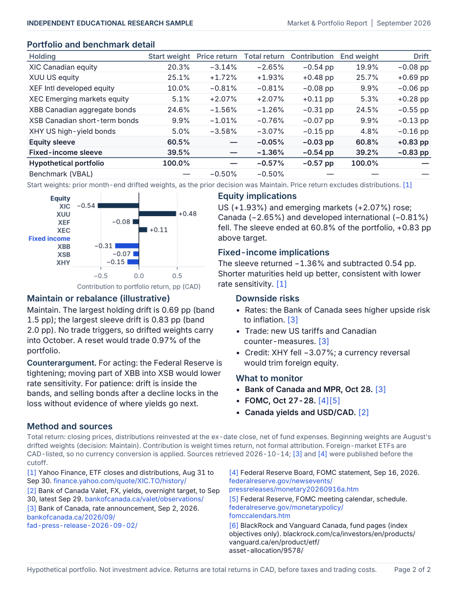

# Market & Portfolio Report

**Independent educational research sample.** Two consecutive, fully completed monthly editions (August and September 2026) of a market commentary and portfolio report for a **hypothetical** balanced portfolio of Canadian-listed ETFs. It is a writing and modelling sample, not investment advice, not affiliated with any financial institution, and not a managed portfolio. No client, proprietary or paid data is used.

Each edition ships three files generated from one shared results object (`mpr/calc.py`):

| File | Content |
|---|---|
| `Market-Portfolio-Report-<YYYY-MM>.pdf` | Exactly two pages: market overview, one evidence-backed theme, portfolio versus benchmark, equity and fixed-income implications, illustrative maintain/rebalance rationale, counterargument and downside risks, what to monitor, method and numbered sources |
| `Market-Portfolio-Workbook-<YYYY-MM>.xlsx` | Overview, Holdings, Returns, Contributions, Assumptions, Sources. Inputs in blue, live formulas elsewhere, freeze panes, filters, chart-ready tables, two native charts |
| `Market-Portfolio-Deck-<YYYY-MM>.pptx` | Exactly three slides with speaker notes: main message, portfolio implications, risks and monitoring |

Generated examples are in `outputs/2026-08/` and `outputs/2026-09/`. Screenshots of the real files are in `docs/screenshots/`.

| Edition | Portfolio | Benchmark (VBAL) | Difference | Month-end decision |
|---|---|---|---|---|
| August 2026 | +1.30% | +1.20% | +0.10 pp | Maintain |
| September 2026 | −0.57% | −0.50% | −0.06 pp | Maintain |




## Regenerate everything

```bash
python3 -m venv .venv && .venv/bin/pip install -r requirements.txt   # once
.venv/bin/python -m mpr build        # both editions, offline, from saved snapshots
.venv/bin/python -m pytest -q        # 47 tests
```

`make build`, `make test`, `make fetch` and `make screenshots` wrap the same commands. `build` never touches the network. `python -m mpr fetch` re-downloads the public snapshots (see the refresh checklist). Screenshots need LibreOffice (`soffice`) to render the deck and workbook; the PDF needs only the Python packages.

## The hypothetical portfolio

Starting point: C$100,000 at the July 31, 2026 close, set to target weights. All holdings are CAD-listed TSX ETFs, so returns are already in Canadian dollars. Rationale lines are design intent, not claims about future performance.

| Ticker | Fund (issuer: iShares) | Class | Weight | Currency treatment | Rationale |
|---|---|---|---|---|---|
| XIC | Core S&P/TSX Capped Composite Index ETF | Equity | 20% | CAD | Domestic core, no currency translation |
| XUU | Core S&P U.S. Total Market Index ETF | Equity | 25% | USD exposure, unhedged | Largest equity market; USD exposure diversifies CAD risk |
| XEF | Core MSCI EAFE IMI Index ETF | Equity | 10% | Foreign, unhedged | Developed markets outside North America |
| XEC | Core MSCI Emerging Markets IMI Index ETF | Equity | 5% | Foreign, unhedged | Small allocation to higher-growth, higher-volatility markets |
| XBB | Core Canadian Universe Bond Index ETF | Fixed income | 25% | CAD | Core government and investment-grade bonds |
| XSB | Core Canadian Short Term Bond Index ETF | Fixed income | 10% | CAD | Lower rate sensitivity and liquidity reserve |
| XHY | U.S. High Yield Bond Index ETF (CAD-Hedged) | Fixed income | 5% | CAD-hedged | Small credit-income allocation without USD/CAD risk |

**Benchmark:** Vanguard Balanced ETF Portfolio (VBAL), a different issuer's balanced fund of index ETFs whose page states a long-term allocation of approximately 60% equity and 40% fixed income. It is separate from the holdings and weights, priced in CAD, and net of fees like the ETFs, so the comparison reflects allocation choices rather than a shared holding. It is a peer-style balanced-fund proxy, not a published index; it rebalances internally on its own schedule.

## Calculation conventions

- **Total return.** Daily closes plus ex-date distributions, reinvested at the ex-date close: `factor_t = (P_t + D_t) / P_{t-1}`. Price return (no distributions) is shown beside total return in the PDF and workbook. Withholding and income taxes are excluded. ETF prices are net of fund management expenses.
- **Beginning-period weights and contributions.** `contribution_i = beginning weight_i x total return_i`, in percentage points of portfolio return. This is a contribution table, not formal performance attribution (no allocation or selection effects).
- **Reconciliation.** Contributions must equal the buy-and-hold daily portfolio path within 1e-9 (`reconciliation_tolerance`). Actual differences are about 1e-17.
- **Rebalancing convention.** At each month-end close: if any sleeve is more than 2.0 pp from the 60/40 target, or any holding more than 1.5 pp from its target, the portfolio is assumed rebalanced to target at that close; otherwise drifted weights carry into the next month. The first edition starts at target. Both editions came out **Maintain**, so September's beginning weights are August's drifted ending weights. The decision is a mechanical illustration, not advice.
- **Costs.** Trading costs and taxes are excluded (`transaction_cost_bps = 0`). The workbook prices an illustrative reset at an adjustable cost input.
- **Currency.** No conversion is performed. XUU, XEF and XEC are unhedged so USD and other currency moves are inside their CAD returns. USD/CAD from the Bank of Canada appears only as context and in one labelled illustration in the August theme (an indicative decomposition, because ETF closes and daily-average rates differ in timing).
- **Data quality.** Missing observations, misaligned dates, non-CAD listings, split events, observations after the cutoff and a stale last observation raise `DataError`. Nothing is forward-filled or set to zero. Bank of Canada series have no September 30 value (federal holiday), so the September edition uses and labels the September 29 observation for yields and USD/CAD.

## Information discipline and sources

Each edition is built only from material that existed at its cutoff:

- Market data: ETF daily closes and ex-dividend events (Yahoo Finance chart endpoint) and Bank of Canada Valet series (USD/CAD, 2- and 10-year Government of Canada yields, overnight target). Requests end at the cutoff date, so snapshots contain nothing later.
- Context documents published before the cutoff: Bank of Canada rate announcements of July 15 and September 2, 2026; FOMC statements of July 29 and September 16, 2026. Each quoted claim is checked against its saved text by `tests/test_editions.py`.
- Retrieved after the cutoff, used only for stable descriptions: iShares and Vanguard fund pages (index objectives, the benchmark's 60/40 policy) and the FOMC meeting calendar (a schedule fixed in advance). No commentary written after a cutoff is used to explain a past decision.
- `data/snapshots/` holds the raw responses, extracted document text and `manifest.json` with URL, publication or observation dates, retrieval timestamps and SHA-256 hashes. These are also the test fixtures. The Sources sheet and the PDF source list show the same facts.

## Layout

```
config/portfolio.json     holdings, weights, benchmark, rebalance rule, editions, macro series
config/sources.json       source catalog (URLs, publication dates, extraction rules)
config/editions/*.json    edition copy with {placeholders}, quotes to verify, expected signs, slide text and notes
mpr/                      fetch, data validation, calc (shared results), charts, narrative, pdf, workbook, deck
data/snapshots/           saved sources, hashes and manifest (source fixtures)
assets/fonts/             Inter Tabular (derived from Inter, SIL OFL 1.1) and licence
tests/                    47 tests: calculations, data handling, editions, output agreement
tools/                    font derivation, LibreOffice rendering, screenshots, PDF fit check
outputs/                  generated PDF, XLSX, PPTX and chart PNGs per edition
docs/screenshots/         PNGs of the real outputs
```

## Tests

`pytest` covers: weights sum to one (target, beginning, ending); date and currency alignment across holdings and benchmark; rejection of missing, stale, misaligned, non-CAD, split and post-cutoff data; stale macro values flagged rather than filled; contributions reconcile to the daily path within tolerance; rebalance thresholds and carry-forward; the snapshot manifest hashes; every quoted claim in the copy appears in its saved source; the copy's direction words match the data; PDF is two pages with only embedded fonts and no text below 9 pt; deck is three slides with notes and no text below 12 pt; workbook sheets, freeze panes, filters, input colouring and live formulas; headline figures identical across calculations, workbook, PDF and slides; and an independent LibreOffice recalculation reproducing every cached workbook formula value (skipped if `soffice` is absent).

## Refresh checklist (what changes between editions)

1. Add an entry to `editions` in `config/portfolio.json`: `start` is the previous edition's `cutoff`, `cutoff` is the new month-end trading day.
2. Copy `config/editions/<previous>.json`, rename it for the new month and list the new documents in `sources` (add them to `config/sources.json` with URL, publication date and extraction markers).
3. `python -m mpr fetch --edition <YYYY-MM>`; check that no snapshot extends past the cutoff and review any stale-data flags.
4. Rewrite the theme, evidence, interpretation, implications, counterargument, risks, monitoring list, slide text and speaker notes. Keep numbers as `{placeholders}` and update `quotes` and `expects` so the build fails if the copy disagrees with the data.
5. Confirm the previous edition's decision: Maintain carries drifted weights forward, Rebalance resets to target (handled in `calc.compute`).
6. `python -m mpr build && python -m pytest -q`, then `python tools/pdf_extents.py outputs/*/*.pdf` to confirm two pages (edit copy, never shrink fonts), render and inspect every page and slide, and run `python tools/screenshots.py`.
7. Add the edition id to `EDITIONS` in the tests.

## Design notes

Light editorial style: canvas `#F8FAFC`, white surfaces, text `#0F172A`, secondary `#475569`, borders `#E2E8F0`, navy `#15324F`, action blue `#1D4ED8`. The UI/UX Pro Max skill was not available, so the design rules in the brief were followed directly. Inter Tabular is Inter with tabular figures mapped to the default digits (`tools/make_tabular_fonts.py`) so decimals align in tables; it is embedded in the PDF. Python-pptx and XlsxWriter cannot embed fonts, so the deck and workbook name `Inter Tabular` and fall back to a system font unless `assets/fonts/` is installed. Portfolio is a solid navy line, benchmark a dashed slate line, bars have zero baselines and value labels, and nothing relies on red and green. XlsxWriter writes the workbook so every formula carries a cached value for previewers; openpyxl is used to validate it in the tests.

## Limitations

- Only two months, one hypothetical portfolio and one balanced-fund benchmark; no statistical claims.
- The Yahoo Finance chart endpoint is an unofficial public source, not an exchange feed. Its terms may restrict redistribution; the snapshots are included only so this educational sample is reproducible. Closes were checked for completeness and alignment, not against an exchange record.
- Distributions are reinvested at the ex-date close, which slightly differs from reinvestment on the pay date; taxes, withholding, bid-ask spreads and trading costs are excluded.
- VBAL is a fund with its own internal rebalancing and fees, not a published index. Benchmark and portfolio both pass through fund fees.
- Fund pages and the FOMC calendar were retrieved after the cutoff; they supply stable descriptions only.
- The deck and workbook were rendered and inspected in LibreOffice, not in PowerPoint or Excel.
- Commentary identifies moves and mechanisms but, as the copy says, does not establish causes.
